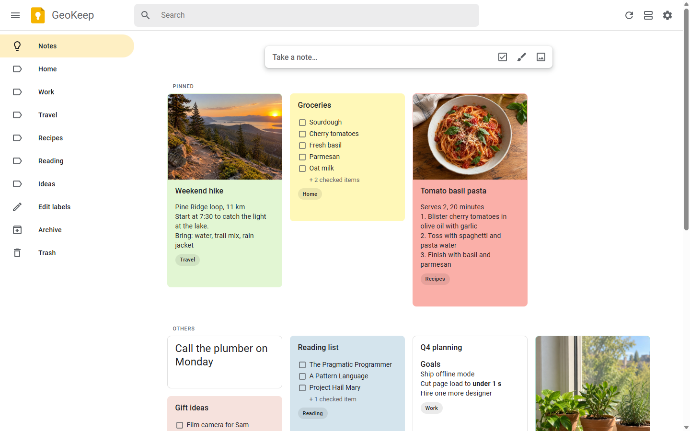
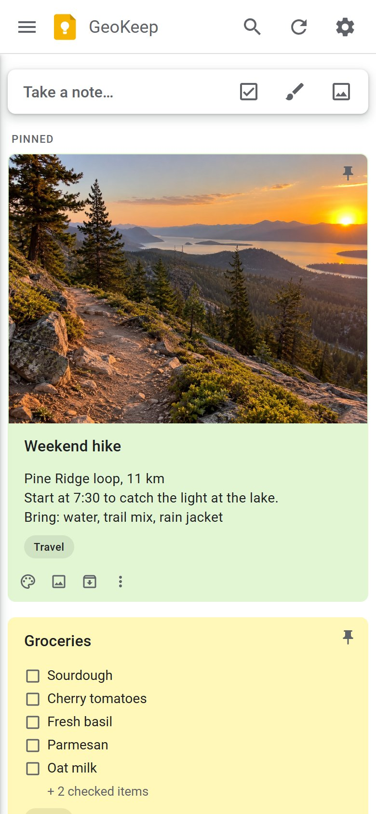
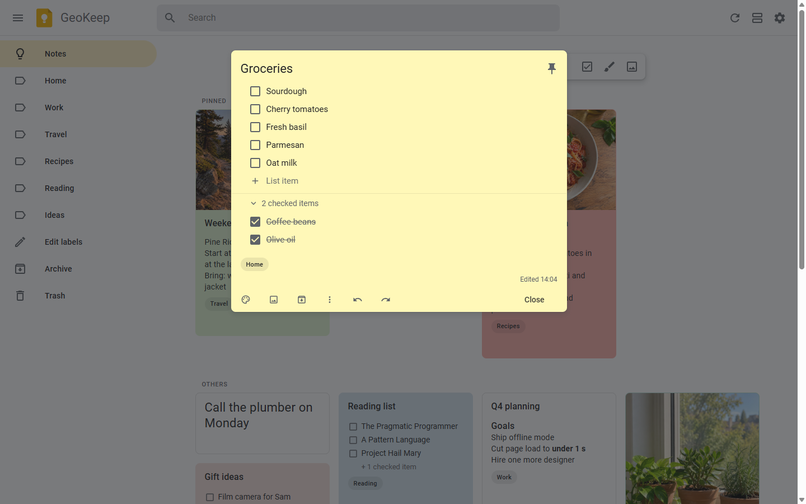
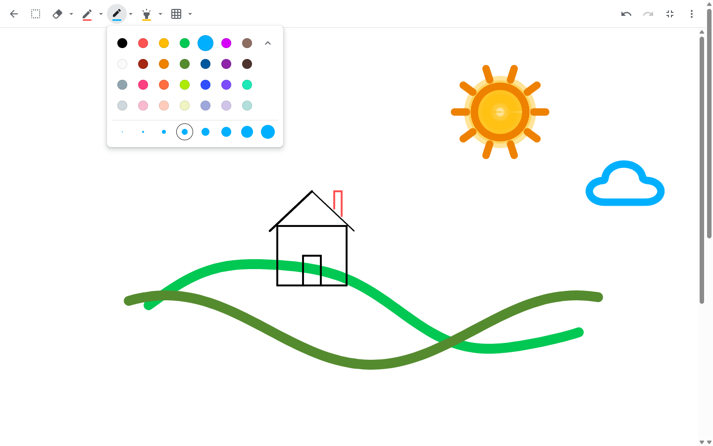
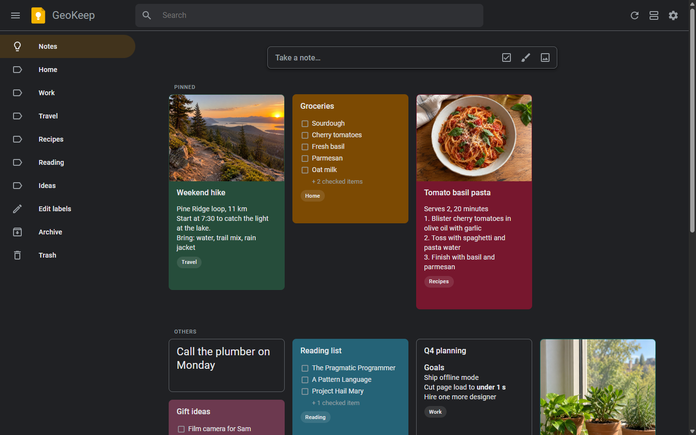

# GeoKeep

A self-hosted Google Keep clone that stores your notes in Google Takeout format. Import your Keep export and keep using it after Keep is gone.

No dependencies and no build step. Requires Node.js 20 or newer.

<p>
  
  
</p>
<p>
  
  
  
</p>

<sub>Demo notes, with photos generated by Codex. Rebuild them with <code>node bench/demo.js &lt;dir&gt; bench/demo-images</code>.</sub>

## Use

```sh
node bin/geokeep.js import <takeout.zip | takeout folder>...
node bin/geokeep.js serve          # http://127.0.0.1:8737
```

You can also import from the web UI: **Settings → Import**.

```
geokeep serve   [--port 8737] [--host 127.0.0.1]
geokeep import  <zip|folder>...
geokeep export  <out.zip> [--no-html]
geokeep snapshot
  --data <dir>          data folder (default ./data, or $GEOKEEP_DATA)
  GEOKEEP_PASSWORD=...  require a password; set it before using --host 0.0.0.0
  GEOKEEP_OFFLINE=1     never fetch link previews from the web
```

## Data

`data/Keep/` holds one JSON file per note, with images and `Labels.txt` alongside, all in Takeout format. Back it up, sync it, or read it with any tool. A snapshot zip is written daily and before every import. See [docs/FORMAT.md](docs/FORMAT.md) for the schema.

Re-importing a newer Takeout replaces a note only when Google's copy is newer, and never deletes anything.

Reminders, collaborators and version history are not restored, because Takeout does not export them.

## Develop

```sh
npm test
node bench/generate.js <dir> 10000 && node bench/server-bench.js <dir> <scratch-data-dir>
```

The browser renders only the cards on screen (a virtual grid), so 50,000 notes still scroll smoothly.
